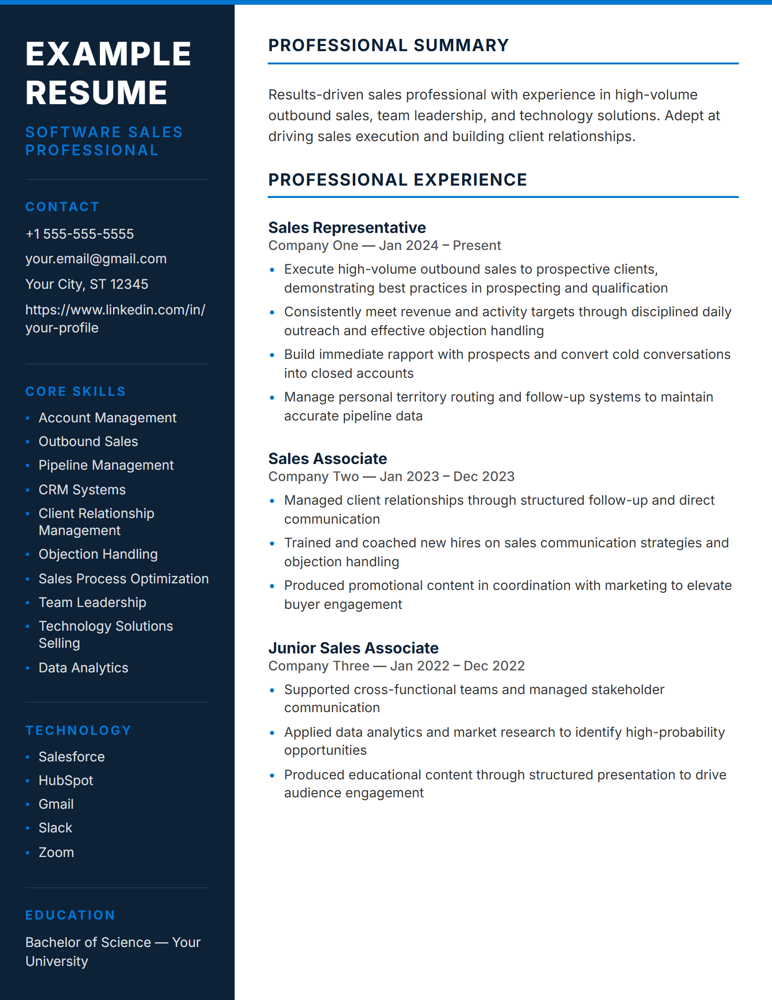
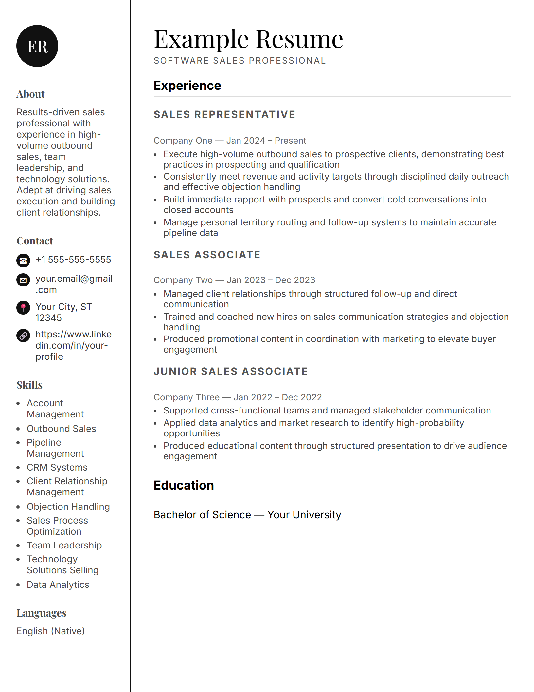
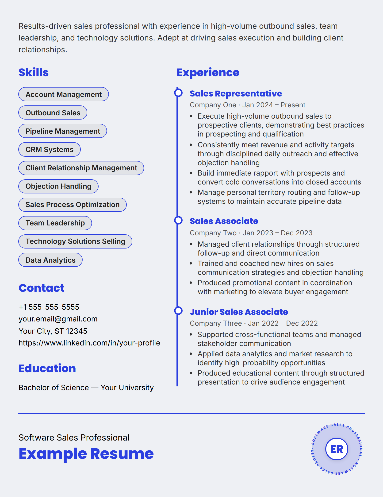

<h1 align="center">TailorCV</h1>

<p align="center"><strong>Paste a job posting, get your resume rewritten for that job, and export it as a one-page PDF.</strong></p>

<p align="center">
Two ways to run it, sharing one idea: the job decides what your resume leads with.
</p>

<p align="center">



</p>

| | [`engine/`](engine) | [`app/`](app) |
|---|---|---|
| **What** | Command-line tool, plus native Claude Code and Hermes Agent skills | Mobile app (iOS, Android and web) built with Expo |
| **Tailoring** | Local Ollama model (default `gemma3`). Your resume does not leave the machine. | On-device model (llama.rn, Qwen2.5-1.5B GGUF) in the processing step, and a Supabase Edge Function for the server path |
| **Designs** | 9 templates, any accent colour, auto-fit to exactly one printed page | Design presets, with PDF export and sharing |
| **Stack** | Node 18+, Playwright for the PDF | Expo SDK 56, React Native, TypeScript, Supabase |
| **Start** | `cd engine && node bin/tailor.js --help` | `cd app && npm install && npx expo start` |

Each folder has its own README with full setup details.

## Who it is for

- Job seekers who want a different resume for each posting without rewriting it by hand.
- People who will not upload a resume to a cloud service. The engine runs entirely on your machine.
- People who only have a phone. The app runs the same workflow on iOS, Android and the web.

## Why two

The engine came first: a design-and-tailoring core that runs from a terminal or inside an agent, for
people who would rather not upload a resume anywhere. The app puts the same workflow on a phone for people
who will never open a terminal. They share the approach (tailor the content to the posting, then fit it to
one page), not code. The app's renderer is React Native, and the engine's renderer is HTML and Playwright.

## Engine quick start

Requires Node.js 18 or newer. The PDF step uses Playwright as an optional peer dependency, and tailoring
needs a running [Ollama](https://ollama.com) server.

```bash
cd engine
npm install playwright
npx playwright install chromium
ollama pull gemma3

node bin/tailor.js --resume my-resume.json --url "https://example.com/job" --company "Acme" --title "Data Analyst"
```

Useful flags:

| Flag | Purpose |
|---|---|
| `--resume <file>` | Your resume as JSON (required). See `engine/examples/example-resume.json`. |
| `--jd`, `--url`, `--text` | The job description, from a file, a URL or inline text. Omit to render the resume as it is. |
| `--company`, `--title` | Target company and role |
| `--template <name>` | One of the 9 built-in templates. Run `--list-templates` to see them. |
| `--accent "#hex"` | Theme colour |
| `--no-ai` | Skip Ollama tailoring even when a job description is given |
| `--model <name>` | Ollama model (default `gemma3`) |
| `--ollama-url <url>` | Ollama base URL (default `http://localhost:11434`) |
| `--custom-template <file.js>` | Use your own design instead of the built-ins. See `engine/examples/custom-template.example.js`. |
| `--out <dir>` | Output directory (default `./output/<date>-<slug>/`) |

The engine also ships as skills for [Claude Code](engine/skills/claude-code/resume-tailor/SKILL.md) and
[Hermes Agent](engine/skills/hermes/resume-tailor/SKILL.md). All three entry points share the rendering,
AI and PDF code in `engine/core/`.

## App quick start

Requires Node.js and a Supabase project.

```bash
cd app
npm install
export EXPO_PUBLIC_SUPABASE_URL=https://YOUR-PROJECT.supabase.co
export EXPO_PUBLIC_SUPABASE_ANON_KEY=YOUR_ANON_KEY
npx expo start          # or: npm run android / npm run ios / npm run web
```

Build an Android APK with EAS:

```bash
eas build --profile preview
```

## Configuration

### App

| Variable | Where it is set | Purpose |
|---|---|---|
| `EXPO_PUBLIC_SUPABASE_URL` | Local environment, and the `preview` profile in `app/eas.json` | Supabase project URL |
| `EXPO_PUBLIC_SUPABASE_ANON_KEY` | Same as above | Supabase anonymous (public) key. It is safe in the client bundle because row-level security controls access. |

The server-side tailoring key is a secret of the Supabase Edge Function, not of the app. It must never be
added to the app bundle or to any `EXPO_PUBLIC_*` variable.

### Engine

The engine takes its settings as command-line flags (listed above). It has no environment variables.

## Project structure

```
tailorcv/
├── app/                       # Expo / React Native app
│   ├── App.tsx, index.ts      # Entry point and navigation
│   ├── screens/               # auth/, tabs/ (Home, History, Profile), wizard/ (upload to result)
│   ├── components/            # Shared UI pieces
│   ├── lib/                   # Supabase client, on-device and server tailoring, PDF, design presets
│   ├── hooks/                 # Network status
│   └── eas.json               # EAS Build profiles
└── engine/                    # Standalone CLI and agent skills
    ├── bin/tailor.js          # CLI entry point
    ├── core/                  # Shared AI, selection, render and PDF code
    ├── templates/             # The 9 built-in HTML templates
    ├── skills/                # Claude Code and Hermes Agent skills
    └── examples/              # Example resume and custom template
```

## Testing

There is no automated test suite in this repository yet. Check engine changes by rendering
`engine/examples/example-resume.json` with a few templates, and check app changes by running
`npx expo start` on a device or simulator.

## Data and privacy

The app stores user accounts and uploaded or tailored resumes, which is personal data, in Supabase.
A privacy policy is required before any public App Store or Play Store release.

The engine writes its output only to the directory given by `--out`, and it sends tailoring requests only to the
Ollama URL you set (default `localhost`).

## Status

Independent product under active development. The Supabase backend project may be paused between
development sessions. Resume it before running the app against it.

## Contributing

There is no contributing guide yet. Open an issue to discuss a change before sending a pull request.

## License

Released under the MIT License. See [LICENSE](LICENSE).
Built by [Dime Data](https://dimedata.cloud).
